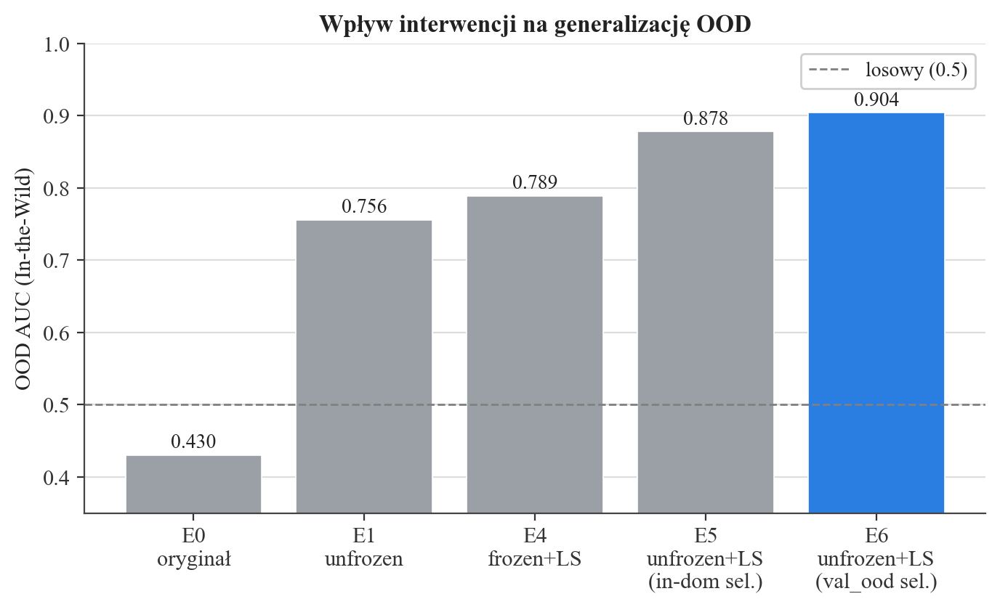
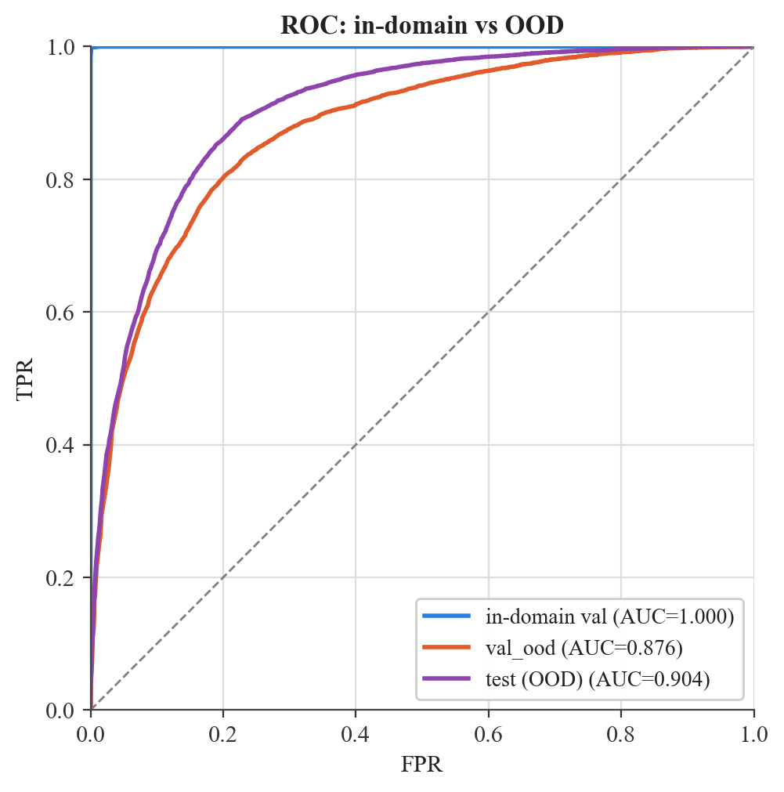
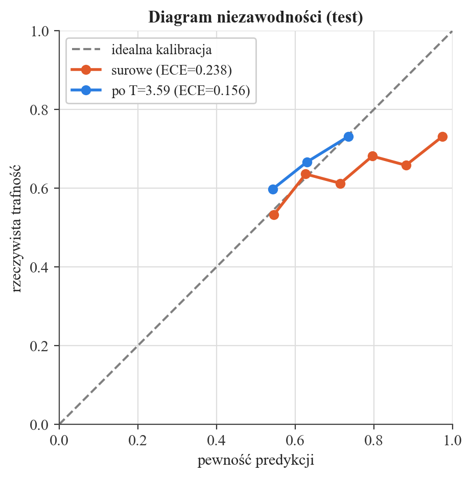

# Voice Deepfake Detection under HD Voice Conditions

[](https://github.com/Sponefy/voice-deepfake-detection-hdvoice/actions/workflows/tests.yml)

Detecting AI-generated (cloned / TTS) speech in **phone-call quality audio**, using a fine-tuned
**Wav2Vec2 XLS-R 300M** model. Code for my engineering thesis at the Polish-Japanese Academy of
Information Technology (PJATK, 2026).

**Headline result:** **AUC 0.904, EER 17.1%** on held-out speakers of the
[In-the-Wild](https://huggingface.co/datasets/mueller91/In-The-Wild) benchmark (real-world
celebrity recordings), up from **AUC 0.43** for the first model, which looked perfect
(AUC ≈ 1.0) on its own test set.



## The problem

Voice cloning makes phone fraud ("CEO calls", "grandchild in trouble") cheap. A detector that
works on clean studio recordings is not enough: real calls are band-limited and compressed by a
speech codec, which destroys many of the artifacts detectors rely on. This project trains and
evaluates a detector on audio passed through a simulated **HD Voice** channel.

## What the project shows

1. **A perfect score was an illusion (shortcut learning).** The first model reached AUC ≈ 1.0
   in-domain but **0.43** on In-the-Wild – worse than random. A logistic-regression baseline on
   trivial features exposed why: **recording length alone gave AUC 0.93** (fakes were much
   longer than real samples), and 6 spectral features without length still gave 0.82. The model
   learned the dataset, not the deepfakes.
2. **Fixing the data mattered more than the model.**
   - Bonafide speech from 4 diverse corpora, **balanced by duration** (4 × 77.1 h), not by file count.
   - The same HD Voice pipeline for both classes, so the channel is not a class shortcut.
   - **Speaker-disjoint splits** with dedicated leakage checks.
   - A short 4 s window with attention masking, so padding carries no information.
   - Base vs XLS-R-300M made almost no difference (0.744 vs 0.759) – added data diversity did.
3. **Honest model selection and calibration.**
   - In-domain validation saturates at AUC 1.0 after ~2 epochs, so it cannot pick the best epoch.
     The epoch is selected on one half of In-the-Wild speakers (`val_ood`); results are reported
     on the other, speaker-disjoint half (`test`).
   - Label smoothing (0.05) stopped full fine-tuning from collapsing into an over-confident shortcut.
   - Decision threshold (Youden J) and **temperature scaling** are fitted on `val_ood`;
     ECE on `test` drops from 0.238 to 0.156.

## Results

| # | Configuration | OOD test AUC | EER |
|---|---|---:|---:|
| E0 | Original model (before data fixes) | 0.430 | – |
| E4 | Frozen encoder + label smoothing, 10 epochs | 0.836 | – |
| E5 | Full fine-tuning + label smoothing, epoch chosen in-domain | 0.884 | – |
| **E6** | **Full fine-tuning + label smoothing, epoch chosen on `val_ood`** | **0.904** | **0.171** |

`test` = 27 In-the-Wild speakers (21 010 clips) never used for training, selection or calibration.
E0 was measured on the full In-the-Wild set (54 speakers).
Full experiment log (in Polish): [docs/experiments_pl.md](docs/experiments_pl.md).

<p align="center">
  
  
</p>

### Limitations

- `val_ood` and `test` come from the same benchmark (different speakers), so the result is
  tuned to that domain more than a fully independent test set would allow.
- At the calibrated threshold the model flags **34% of real recordings** as fake
  (bonafide accuracy 0.66, spoof accuracy 0.91). EER ≈ 17% is a research result, not a
  production-ready detector.
- Single training runs (no seed repeats); large per-speaker variance on In-the-Wild.
- HD Voice is simulated with **Opus** at AMR-WB bitrates (6.6–23.85 kbps), not with the actual
  AMR-WB / EVS codecs.

## Pipeline

```
raw corpora ──► HD Voice simulation ──► duration-balanced, speaker-disjoint split ──► leakage audit
              (16 kHz mono, 50–7000 Hz            (CSV: train / val / val_ood / test)
               band-pass, Opus VoIP)
        ──► training (Wav2Vec2 XLS-R 300M + MLP head) ──► OOD evaluation, threshold + temperature calibration
```

**Model:** `facebook/wav2vec2-xls-r-300m` encoder (fully fine-tuned) → masked mean pooling →
MLP head 1024 → 256 → 128 → 2. AdamW (lr 5e-5), mixed precision, gradient accumulation,
class-balanced sampling, early stopping. Trained on a single RTX 4080 SUPER (~45 min/epoch).

## Data

~616 h in total: 308 h of real speech and 308 h of synthetic speech from 10 TTS generators.
**No audio or model weights are included in this repository.**

| Role | Dataset |
|---|---|
| Real speech | [VCTK](https://datashare.ed.ac.uk/handle/10283/3443), [LibriTTS-R](https://huggingface.co/datasets/mythicinfinity/libritts_r), [Common Voice (en)](https://commonvoice.mozilla.org/), [People's Speech](https://huggingface.co/datasets/MLCommons/peoples_speech) |
| Synthetic speech | [AUDETER](https://huggingface.co/datasets/wqz995/AUDETER) |
| Out-of-domain evaluation | [In-the-Wild](https://huggingface.co/datasets/mueller91/In-The-Wild) (Müller et al., *Does Audio Deepfake Detection Generalize?*, Interspeech 2022) |

Check each dataset's license before use.

## Repository structure

```
Code/
  projectMethods.py      # device selection, paths, dataset-version → split CSV
  audio/                 # HD Voice channel simulation (audioMethods, compressDataset)
  model_training/        # model + trainer (detector.py), Dataset (datasetMethods.py), entry point (train.py)
  model_testing/         # OOD evaluation, calibration, shortcut baseline, plots
  other/                 # corpus download/extraction, split building and auditing
tests/                   # pytest unit tests (run on CPU with a tiny random Wav2Vec2)
docs/                    # experiment log and figures
```

| Step | Script |
|---|---|
| HD Voice simulation | `Code/audio/audioMethods.py`, `Code/audio/compressDataset.py` |
| Split building and audit | `Code/other/createBalancedOodSplit.py`, `checkSplitLeakage.py`, `verifySplitIntegrity.py` |
| Training | `Code/model_training/train.py`, `detector.py`, `datasetMethods.py` |
| Shortcut diagnosis | `Code/model_testing/logisticRegressionBaseline.py` |
| Evaluation and plots | `Code/model_testing/evalOodFromCsv.py`, `plotOodResults.ipynb` |

## Running it

Requirements: Python 3.11, [PyTorch](https://pytorch.org/get-started/locally/) with CUDA (installed
separately), FFmpeg with `libopus`.

```bash
pip install -r requirements.txt          # or: conda env create -f environment.yml
pytest                                   # unit tests, CPU only, no data needed
```

Data is expected under `AudioFiles/` and models under `Models/` in the repository root
(override with the `DEEPFAKE_PROJECT_ROOT` environment variable).

```bash
python Code/audio/compressDataset.py           # raw → HD Voice
python Code/other/createBalancedOodSplit.py    # build the split CSV
python Code/model_training/train.py            # train + evaluate on test
python Code/model_testing/evalOodFromCsv.py    # AUC/EER, threshold and temperature calibration
```

Code comments and console output are in Polish.

## Acknowledgements

Engineering thesis supervised by mgr inż. Konrad Maciborski (PJATK).

## License

[MIT](LICENSE) for the code. Datasets and pretrained models keep their own licenses.
